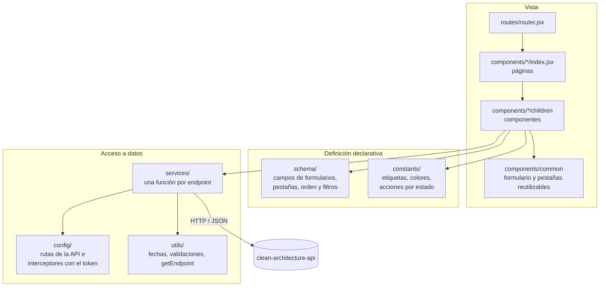
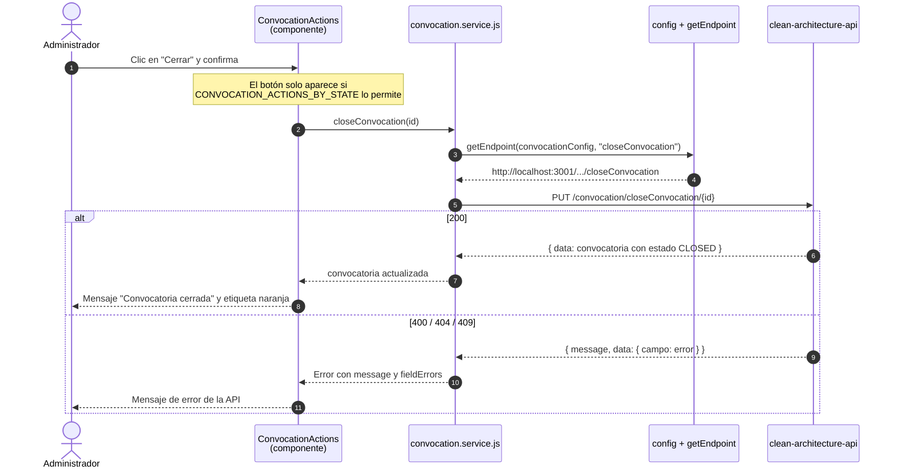
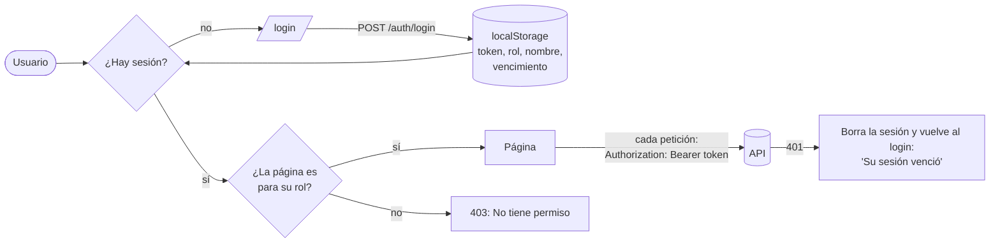
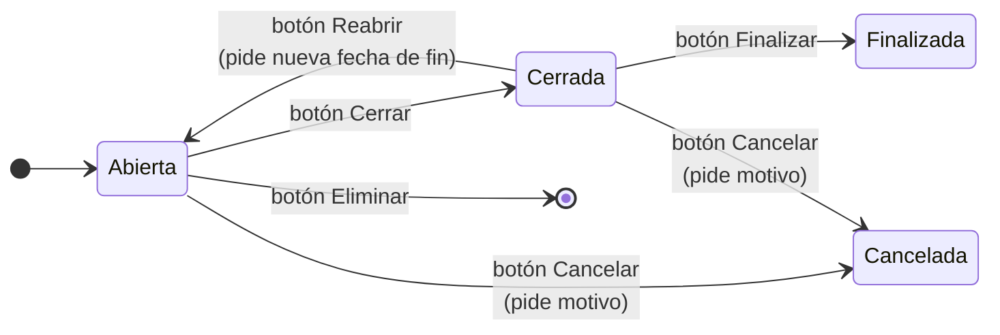

<h1 align="center">clean-architecture-front</h1>

<p align="center">
  Aplicación web del <b>Sistema de Convocatorias</b> de la Universidad de Caldas · Semillero SOLID
</p>

<p align="center">
  
</p>

<p align="center">
  
  
  
  
  
  
</p>

---

Este repositorio es la interfaz del sistema. Consume la API REST de [clean-architecture-api](https://github.com/SemilleroSOLID/clean-architecture-api), que es donde viven las reglas del negocio y donde está la **documentación general del sistema** (arquitectura completa, estados, diagramas). Este README explica cómo está construido el front por dentro.

> **Para verlo funcionando** no hace falta instalar Node: con el `docker compose up -d --build` del API se levanta todo el sistema, este front incluido, en http://localhost:5173 ([Empezar rápido](https://github.com/SemilleroSOLID/clean-architecture-api#empezar-rápido)). Node solo hace falta para [desarrollar](#cómo-ejecutarlo).

## Contenido

1. [Qué hace](#qué-hace)
2. [Tecnologías](#tecnologías)
3. [Arquitectura del front](#arquitectura-del-front)
4. [Estructura de carpetas](#estructura-de-carpetas)
5. [Cómo fluye una acción](#cómo-fluye-una-acción)
6. [Sesión y rutas por rol](#sesión-y-rutas-por-rol)
7. [Decisiones de diseño](#decisiones-de-diseño)
8. [Estados de la convocatoria en la interfaz](#estados-de-la-convocatoria-en-la-interfaz)
9. [Cómo ejecutarlo](#cómo-ejecutarlo)
10. [Cómo agregar una pantalla](#cómo-agregar-una-pantalla)
11. [Lo que no conviene copiar](#lo-que-no-conviene-copiar)

## Qué hace

| Pantalla | Ruta | Rol | Qué permite |
|---|---|---|---|
| Iniciar sesión | `/login` | Público | Correo y contraseña; es lo único que se ve sin sesión. |
| Inicio | `/` | Ambos | Saludo y accesos a lo que puede hacer el rol de la sesión. |
| Convocatorias · Consultar | `/convocation` | Ambos | Ver las convocatorias como tarjetas, ordenarlas y filtrarlas por tipo y estado, y abrir el detalle con sus requisitos. El administrador, además, edita, elimina, cierra, reabre, finaliza o cancela según el estado. |
| Convocatorias · Crear | `/convocation` (pestaña *Crear*) | Administrador | Formulario con título, tipo, descripción, fechas y requisitos, validado antes de enviarlo y con confirmación del resultado. |
| Convocatorias · Tipos | `/convocation` (pestaña *Tipos*) | Ambos | Tipos de convocatoria disponibles. |
| Postularme | `/request` | Estudiante | Formulario de postulación en cuatro pasos: elegir una convocatoria abierta (con su información y requisitos), ingresar un valor por requisito con adjunto opcional, revisar y corregir antes de confirmar, y ver el resultado de la verificación automática: activa, o pendiente con la lista de requisitos que no cumple. |
| Mis solicitudes | `/my-requests` | Estudiante | Historial del estudiante de la sesión: cada convocatoria a la que se postuló con su tipo, fechas y el estado de la solicitud, ordenable por fecha de postulación o por estado, y el motivo cuando fue rechazada. Tiene accesos para volver a las convocatorias o postularse. Las solicitudes en revisión se pueden **retirar**, con confirmación. |
| Revisar solicitudes | `/admin/requests` | Administrador | Sección del administrador: tabla con todas las solicitudes (estudiante, convocatoria, fecha y estado), filtros por convocatoria y estado, y el detalle de cada una con la verificación requisito por requisito. Las pendientes se resaltan con los requisitos que no cumplen, y desde el detalle se aprueban o se rechazan con justificación obligatoria cuando la convocatoria está cerrada. |

## Tecnologías

| Tecnología | Versión | Para qué |
|---|---|---|
| React | 18 | Componentes y estado de la interfaz. |
| Vite | 8 | Servidor de desarrollo y empaquetado. |
| Ant Design | 6 | Componentes visuales: formularios, tarjetas, modales, mensajes, selector de fechas. |
| React Router | 7 | Navegación entre páginas. |
| Axios | 1 | Peticiones HTTP a la API. |
| Day.js | 1 | Manejo de fechas en los formularios. |
| Lodash | 4 | Utilidades (`isEmpty`, etc.). |
| ESLint | 9 | Reglas de estilo y errores comunes de React. |

## Arquitectura del front

El front no tiene reglas del negocio: las reglas reales están en la API. Lo que sí hace es separar responsabilidades para que la vista no sepa de HTTP y la configuración no esté repartida por los componentes.



| Capa | Carpeta | Responsabilidad | No debe |
|---|---|---|---|
| Vista | `components/`, `routes/`, `styles/` | Mostrar datos y reaccionar a lo que hace el usuario. | Llamar a Axios ni armar URLs. |
| Definición | `schema/`, `constants/` | Describir formularios, listas y textos como datos. | Tener lógica de red. |
| Datos | `services/`, `config/`, `utils/` | Hablar con la API y traducir sus respuestas y errores. | Importar componentes. |

Es la misma idea de la regla de dependencias del backend aplicada a un front: la vista depende de los servicios, pero los servicios no saben qué componente los usa.

## Estructura de carpetas

```text
src/
├── main.jsx                    ← punto de entrada: interceptores de Axios + router
├── routes/router.jsx           ← rutas, cada una protegida por rol
├── context/, hooks/            ← AuthContext y useAuth (sesión)
├── components/
│   ├── auth/                   ← login, AuthProvider y ProtectedRoute
│   ├── common/                 ← CommonForm, InputWrapper, Tabs (reutilizables)
│   ├── layout/                 ← encabezado (menú por rol y cerrar sesión), pie y contenedor
│   ├── home/                   ← página de inicio
│   ├── convocation/
│   │   ├── index.jsx           ← página con pestañas Consultar / Crear / Tipos
│   │   ├── children/           ← lista, detalle, formulario, acciones por estado
│   │   └── inputs/             ← selector de tipo de convocatoria
│   ├── requirement/            ← modal y tarjeta para agregar requisitos
│   ├── request/                ← postulación: selección, requisitos, revisión y resultado
│   ├── requestAdmin/           ← administrador: lista de solicitudes con filtros, detalle y decisión
│   └── studentRequests/        ← estudiante: historial de sus solicitudes
├── schema/                     ← formularios, pestañas y opciones de la lista como datos
├── constants/                  ← etiquetas y colores de estados y tipos, acciones por estado, rutas
├── services/                   ← auth, convocation, requirement y request
├── config/                     ← host y endpoints de cada recurso de la API, e interceptores de Axios
├── utils/                      ← sesión, fechas, validaciones, getEndpoint, toRequestError y utilidades de la solicitud
└── styles/                     ← CSS por módulo
```

## Cómo fluye una acción

Ejemplo: el administrador cierra una convocatoria desde su detalle.



## Sesión y rutas por rol

Todo el front pide iniciar sesión contra `POST /auth/login` del backend.



| Pieza | Archivo | Qué hace |
|---|---|---|
| `AuthProvider` + `useAuth` | `components/auth/authProvider.component.jsx`, `context/`, `hooks/` | Guarda la sesión, inicia y cierra sesión, y la cierra sola cuando llega la hora de vencimiento del token. |
| `ProtectedRoute` | `components/auth/protectedRoute.component.jsx` | Sin sesión redirige al login; con un rol que no corresponde muestra *"No tiene permiso para ver esta página"*, aunque se escriba la URL a mano. |
| Login | `components/auth/login/` | Correo y contraseña; muestra el error del API y por qué se volvió al login (sesión vencida o cerrada). En desarrollo muestra los usuarios de prueba. |
| Interceptores de Axios | `config/axios.config.js` | Agregan el token a todas las peticiones y, ante un 401, borran la sesión y vuelven al login con el mensaje de sesión vencida. |
| Sesión guardada | `utils/session.util.js` | Lee y escribe la sesión en `localStorage`, con cada acceso protegido por si el navegador lo bloquea. |
| Roles por página | `constants/links.constant.js` | Cada enlace dice qué roles lo pueden abrir; el menú, el inicio y las rutas salen de ahí. |

| Rol | Menú | No puede |
|---|---|---|
| Administrador | Convocatorias (con *Crear* y las acciones del detalle) y Revisar solicitudes | Postularse ni ver *Mis solicitudes*. |
| Estudiante | Convocatorias (solo consulta), Postularme y Mis solicitudes | Crear, editar ni cambiar el estado de convocatorias, ni revisar solicitudes. |

Ocultar un botón no es seguridad: el backend vuelve a revisar el rol y el dueño de cada solicitud en cada petición. El front solo evita mostrar lo que el usuario no puede usar.

El estudiante ya no se elige en una lista: es el de la sesión. El formulario de postulación y *Mis solicitudes* no mandan su id; el backend lo toma del token.

Usuarios de desarrollo: `admin@ucaldas.test` / `Admin2026*` y cada estudiante con su correo (por ejemplo `laura.gomez@ucaldas.test`) / `Estudiante2026*`. Con `npm run dev` la pantalla de login los muestra; en el build de producción (el del compose) no aparecen.

## Decisiones de diseño

**Formularios definidos como datos.** Los campos del formulario de convocatoria no se escriben uno por uno en JSX. Están descritos en `schema/createConvocation.schema.js` (etiqueta, nombre, componente, reglas) y `CommonForm` los dibuja. El mismo esquema sirve para crear y para editar; al editar solo cambia la regla de la fecha de inicio.

```js
// schema/createConvocation.schema.js
{
  label: "Titulo",
  name: "title",
  rules: [{ whitespace: true, message: "El título no puede estar vacío" }],
  component: Input,
  childrenProps: { placeholder: "Ingrese el nombre de la convocatoria" }
}
```

**Validación en dos niveles.** El front valida antes de enviar (campos obligatorios, fecha de inicio posterior a hoy, fin al menos un día después del inicio, valor del requisito entre 0 y 5 si es una nota) para dar respuesta inmediata. La API vuelve a validar todo, porque es la que tiene la última palabra. Si la API rechaza un campo, `toRequestError` toma el mapa `campo → mensaje` de la respuesta y el formulario lo muestra debajo del campo con `form.setFields`.

**Constantes alineadas con el backend.** `constants/convocation.constant.js` tiene los mismos valores que los enums de la API (`OPEN`, `CLOSED`, `MONITORING`...), con su etiqueta en español y su color. La interfaz nunca muestra el valor técnico.

**Configuración centralizada.** La URL base sale de la variable `VITE_API_HOST` y cada recurso tiene su archivo en `config/` con sus endpoints. Los servicios arman la URL con `getEndpoint(config, "clave")`, así que un cambio de ruta en la API se corrige en un solo lugar.

**Fechas como texto `AAAA-MM-DD`.** Es el formato que intercambia con la API. Por eso la lista puede ordenar por fecha comparando texto, y `formatDate` las muestra como `dd/mm/aaaa`.

## Estados de la convocatoria en la interfaz

El ciclo de vida lo decide la API con el patrón State ([explicación completa](https://github.com/SemilleroSOLID/clean-architecture-api#ciclo-de-vida-de-una-convocatoria)). El front lo refleja así:



| Estado | Etiqueta | Botones visibles en el detalle |
|---|---|---|
| `OPEN` | 🟢 Abierta | Editar, Cerrar, Cancelar, Eliminar |
| `CLOSED` | 🟠 Cerrada | Reabrir, Finalizar, Cancelar |
| `FINISHED` | 🔵 Finalizada | Ninguno |
| `CANCELLED` | 🔴 Cancelada | Ninguno |

Los botones salen de `CONVOCATION_ACTIONS_BY_STATE`. Ocultarlos es solo una ayuda para el usuario: si alguien llamara la API directamente, la API igual rechazaría la acción.

## Cómo ejecutarlo

**Todo el sistema con Docker:** desde `clean-architecture-api`, `docker compose up -d --build` levanta también este front en http://localhost:5173. La imagen (`Dockerfile`) compila el front con `npm run build` y lo sirve con nginx (`nginx.conf`), que responde `index.html` en cualquier ruta para que funcionen `/login`, `/my-requests`, etc. La dirección del API se fija al construir con el argumento `VITE_API_HOST`.

**Para desarrollar** con recarga automática: `docker compose stop front` en `clean-architecture-api` y luego, aquí, lo siguiente. Requisitos: Node.js 22 (ver `.nvmrc`) y la API corriendo en `http://localhost:3001` ([instrucciones](https://github.com/SemilleroSOLID/clean-architecture-api#cómo-ejecutar-todo-el-sistema)).

```bash
npm install
cp .env.example .env
npm run dev
```

Abre http://localhost:5173.

| Variable | Valor |
|---|---|
| `VITE_API_HOST` | `http://localhost:3001/ms-logica-negocio/api` |

| Script | Qué hace |
|---|---|
| `npm run dev` | Servidor de desarrollo en el puerto 5173. |
| `npm run build` | Genera la versión de producción en `dist/`. |
| `npm run preview` | Sirve la versión de producción para probarla. |
| `npm run lint` | Revisa el código con ESLint. |

> Si `npm run dev` falla con `Cannot find native binding` (`@rolldown/binding-win32-x64-msvc`), `node_modules` se instaló desde otro sistema operativo. Borra `node_modules` y vuelve a ejecutar `npm install`.

## Cómo agregar una pantalla

Así se construyó el formulario de postulación, y es el mismo camino para cualquier pantalla nueva:

1. **config/** · `request.api.config.js` con el host `${VITE_API_HOST}/request` y el endpoint `createRequest`.
2. **services/** · `request.service.js` con `createRequest(request)`, usando `getEndpoint` y traduciendo los errores con `toRequestError` (`utils/requestError.util.js`).
3. **schema/** · `createRequest.schema.js` describe los campos como datos: uno por requisito de la convocatoria, más su adjunto opcional.
4. **components/request/children/** · `createRequest` coordina los pasos y usa `CommonForm`, el esquema y el servicio; cada paso es un componente pequeño (`selectConvocation`, `requestReview`, `requestResult`).
5. **routes/** y **constants/links.constant.js** · solo si la pantalla necesita una ruta nueva.

## Lo que no conviene copiar

Algunas decisiones del front son atajos aceptados para mantener el proyecto simple. Están explicadas con los demás antipatrones del sistema en el [README del API](https://github.com/SemilleroSOLID/clean-architecture-api#antipatrones-dónde-cómo-y-por-qué); las que tocan este repositorio:

| Qué | Por qué está así | Qué sería lo correcto |
|---|---|---|
| El token se guarda en `localStorage` (`utils/session.util.js`) | Es la forma más simple de que la sesión sobreviva al recargar con un JWT sin sesión en el servidor. | Una cookie `HttpOnly` emitida por el backend, para que un script inyectado (XSS) no pueda leer el token. |
| Las rutas del API tienen verbos (`/getAllConvocations`, `/createConvocation`) | El front se construyó sobre la API original; cambiarlas obligaba a cambiar los dos lados a la vez. | Rutas REST (`GET /convocations`) en el API y en `config/`. |
| La dirección del API queda fija en el build (`VITE_API_HOST`) | Vite reemplaza las variables `VITE_*` al compilar, así que la imagen sirve archivos estáticos. | Para otro servidor hay que reconstruir la imagen con otro `VITE_API_HOST`, o leer la dirección de un archivo de configuración al cargar la página. |
| Algunas reglas se validan en el front y en el API | Es duplicación **a propósito**: el front avisa de inmediato y el API tiene la última palabra. | Mantenerla, pero sin agregar reglas que existan solo en el front. |

Todas las issues del sistema están en [clean-architecture-api](https://github.com/SemilleroSOLID/clean-architecture-api/issues).

---

<p align="center">Semillero SOLID · Universidad de Caldas</p>
